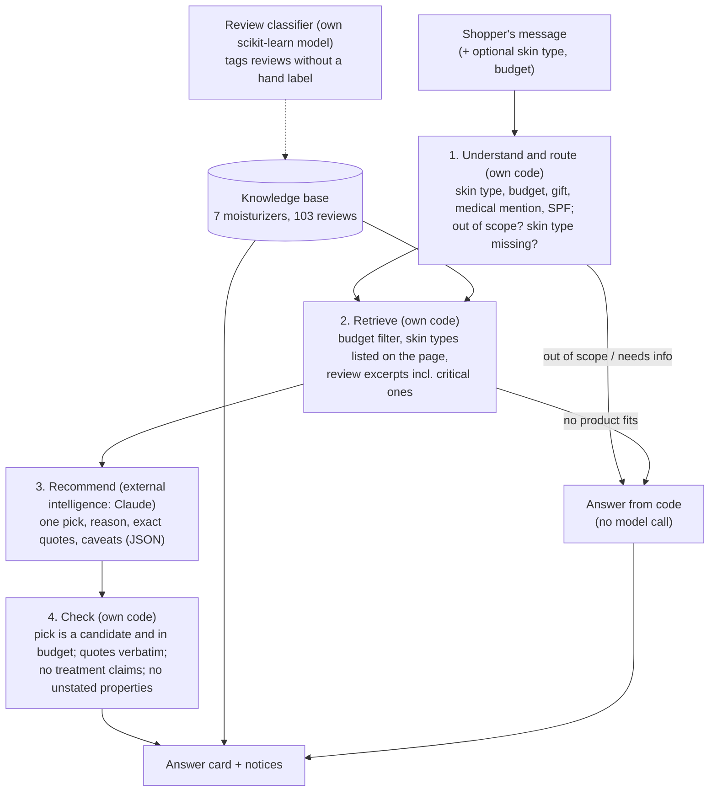

# Beauty Helper: product documentation

## Persona

**Mei**, 24, buying her first proper moisturizer. She has oily skin, lives in humid Singapore, and is overwhelmed by choices and by reviews that mostly praise
delivery. She wants one sensible suggestion within her budget, with real reviews behind it. A second user is **Daniel**, buying a moisturizer as a gift for his mother,
who has very dry skin: he does not know skincare terms and cares about budget.

## Input

A free-text message ("I have oily skin, live in humid Singapore, and want a light moisturizer under S$40"), optionally a skin type and a budget in S$ chosen in the form.

## Output

One answer card:

| Part | Source |
| --- | --- |
| Recommended product: name, price and date, size, link, skin types listed on its page | Knowledge base (code), never the model |
| Why (about 70 words), "good to know" points, other options | Claude, after the checks below |
| Review quotes, each tagged positive or negative and "hand" or "model" | Quotes proposed by Claude, kept only if they appear word for word in the picked product's reviews |
| Number of reviews in the knowledge base (positive, negative), with a note that they are not a random sample | Knowledge base (code) |
| Notices: doctor/pharmacist notice when a medical condition is mentioned; "no sunscreen in these products" when SPF is asked for; patch-test and not-medical-advice line | Code |
| Other outcomes: a question asking for the skin type, "out of scope" (anti-ageing, sunscreen, makeup ...), "no product within that budget" | Code, without calling the model |

## High-level architecture



Plain box version:

```
 Shopper's message (+ skin type, budget)
        |
        v
+---------------------------------+   out of scope / needs info
| 1. Understand and route (code)  |----------------------------+
+---------------------------------+                            |
        |                                                      v
        v                                          +---------------------+
+---------------------------------+  no product fits| Answer from code    |
| 2. Retrieve (code)              |---------------->| (no model call)     |
|  budget + page skin types       |<--- Knowledge   +---------------------+
|  review excerpts                |     base (7 products, 103 reviews)
+---------------------------------+          ^  (reviews tagged by the
        |                                    |   own sentiment classifier)
        v                                    |
+---------------------------------+          |
| 3. Recommend (Claude, JSON)     |          |
+---------------------------------+          |
        |                                    |
        v                                    |
+---------------------------------+          |
| 4. Check (code): pick, budget,  |----------+---> Answer card + notices
|  verbatim quotes, no cure claims|
+---------------------------------+
```

### Where the intelligence comes from

| Component | Type | Role |
| --- | --- | --- |
| Routing and retrieval (`app/logic.js`) | Own code | Decides what the model may see; answers some requests without it |
| Review sentiment classifier (`scripts/train_classifier.py`, exported to `app/model.json`) | Own narrow ML model (scikit-learn), also run in the page | Tags reviews that have no hand label; "Review classifier" tab |
| Claude (through the Claude artifact runtime, default model tier) | External LLM | Chooses among the candidates and writes the reason, caveats and quotes |
| Checks (`verifyAnswer` in `app/logic.js`) | Own code | Limits what the model can get wrong |

No vector database and no web search or other tools are used. The Week 3 plan (Dify or Coze with GPT-4o-mini) was replaced by Claude plus own code; the reasoning
is in `REPORT.md`.

## Metrics: targeted and reached

| Metric | Targeted | Reached |
| --- | --- | --- |
| Assistant: pass rate on 14 scenario questions | at least 80% (the problem statement's bar) | 14 of 14 (100%), automatic checks, no manual overrides |
| Assistant: right kind of answer | at least 90% | 14 of 14 |
| Assistant: recommendations with at least one verified quote | at least 90% | 9 of 9 |
| Assistant: quotes rejected as not verbatim | at most 10% of those proposed | 0 of 24 |
| Assistant: claims removed by the checks | no target (reported) | 1 (a treatment claim in the "cures eczema" test) |
| Assistant: average time per model call | at most 20 s | 5.9 s (4.9 to 8.1); 3.8 s over all 14 questions, five of which are answered by code |
| Assistant: input tokens per recommendation | no target (reported) | about 2,200 to 3,100, mean about 2,700 (estimate: characters / 4; `node scripts/estimate_tokens.js`); output size is estimated on the page from the JSON returned |
| Classifier: accuracy, hold-out (25 reviews) | at least 80% | 88% |
| Classifier: accuracy, 5-fold cross-validation | at least 80% | 87% (+/- 5) |
| Classifier: accuracy on products it has not seen (grouped by product, 5 products) | at least 80% | 76% (+/- 16): **target missed** |
| Classifier: share of negative reviews found | no target set | about 64% (25 of 39 in cross-validation) |

Reading the assistant's numbers: 14 of 14 is weak evidence. The questions were written after the data was collected, a pass only requires that the pick lists the skin type and fits the budget, five questions are decided by code, and the author read only three of the nine recommendations (questions 7, 13 and 14, all judged Pass; the model had written an internal product code in one, now replaced by the product name). Six of the nine picks were CeraVe, the product with the most reviews. See `evals/README.md`.

The 80% bar comes from the problem statement; the other targets were set while building the project. Details and limits: `evals/README.md`, `results/NOTES.md`.

## Known limitations

7 products only (the plan was 15 to 30); prices are sale prices seen on one day; reviews are not a random sample and are mostly positive; the classifier misses about a third
of negative reviews and is weaker on unseen products; keyword-based retrieval; the assistant needs a Claude account to run; information is general, not medical advice.
